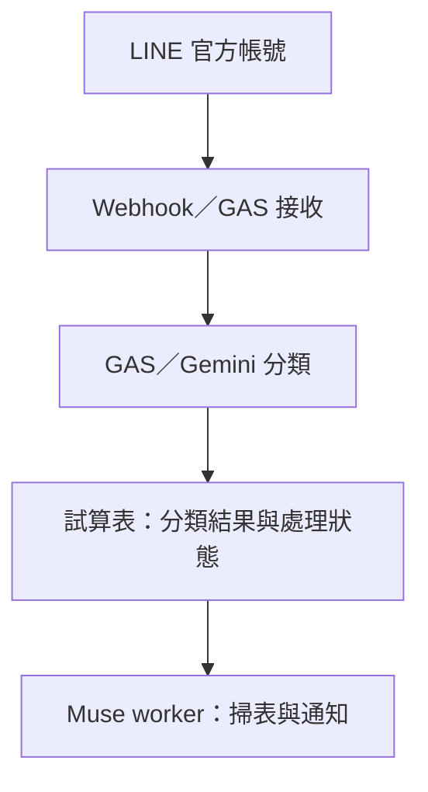
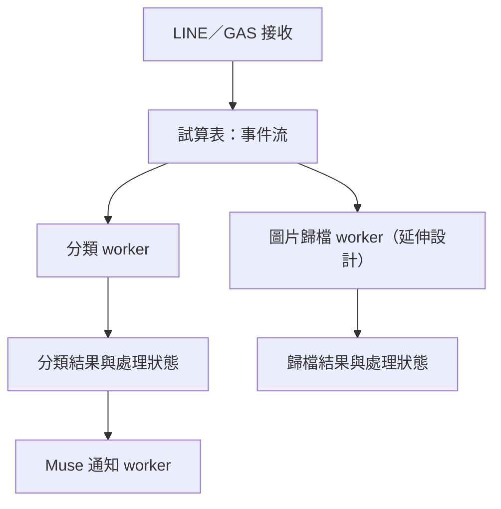

# LINE 官方帳號訊息管線｜架構與延伸應用設計

使用專門申請的 LINE 官方帳號進行實際串接測試，探索訊息接收、AI 分類與通知的自動化流程。本文只公開架構，不公開 GAS 程式碼、憑證、部署網址、試算表識別碼或實際訊息資料。

## 解決的問題

LINE 訊息累積時，需要追蹤哪些事項尚待處理。設計以「待處理 → 已完成」的明確狀態作為依據，避免只依賴是否出現回覆來推測完成情況。

## 既有流程

GAS 負責接收與分類，試算表承接資料與處理狀態，Muse 作為獨立通知 worker。各模組透過資料交接，分別演進。

此為測試系統與作品架構展示，不代表對外開放服務；本文件不取代政策告知或資料處理同意。

## 延伸應用：獨立 worker 承接新功能

圖片歸檔可沿用同樣邏輯：新增另一個 worker，從「事件流」分頁讀取待處理項目，再寫回歸檔結果與狀態。

圖片歸檔是後續延伸設計，並非宣稱已完成的功能。在事件欄位與存取介面足夠的前提下，可新增 worker 而不修改既有 webhook、分類或通知程式。

### 模組間的資料合約

可用事件 ID、類型、接收時間、受控內容參照與處理狀態作為交接欄位。這是設計建議，不公開實際試算表結構或資料。

各 worker 應管理自己的處理狀態、去重及失敗重試，避免互相覆寫；錯誤摘要需遮蔽敏感內容，資料存取依用途限制權限。

## 何時拆成另一個 GAS 專案

同專案多檔是預設；下列需求出現時再拆分：

1. **故障隔離**：圖片下載逾時不應阻塞分類。分開執行與管理 trigger、執行紀錄及重試，降低連帶影響。共用帳號或外部服務配額仍可能互相影響。
2. **權限範圍不同**：不同帳號授權、API 憑證或資料存取範圍，分開管理。
3. **迭代節奏不同**：分類 prompt 常調整，webhook 相對穩定；需要獨立發布與回復時，拆開部署單位。

## AI 協作與驗證

我負責需求、架構決策、部署授權與驗收；AI 協助程式實作、除錯分析與文件整理。

測試曾遇到 trigger 未執行與錯誤被吞掉的情況，因此不只看「執行成功」，還要確認：

- trigger 實際觸發，待處理資料有被接手。
- 分類結果與狀態正確寫回。
- API 失敗不會被誤判成「不重要」。
- 模型名稱與 API 可用性經實測確認。
- 故障能與「沒有新訊息」區分，並設計獨立健康檢查。

## 公開範圍

只提供架構、分工與延伸設計。實際官方帳號的 GAS 程式碼、LINE Token／Secret、API key、連線設定及使用者資料不公開。
